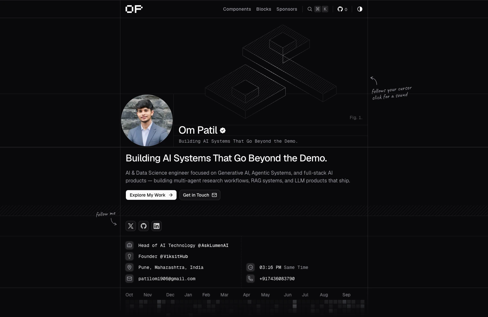

# [heyompatil.me](https://heyompatil.me)

<p>
  <picture>
    <source media="(prefers-color-scheme: dark)" srcset="https://shieldcn.dev/header/grid.svg?title=heyompatil.me&amp;subtitle=Portfolio%2C+blog%2C+and+shadcn+registry+by+Om+Patil.&amp;logo=data%3Aimage%2Fsvg%2Bxml%2C%3Csvg%20xmlns%3D%22http%3A%2F%2Fwww.w3.org%2F2000%2Fsvg%22%20fill%3D%22none%22%20viewBox%3D%220%200%20701.35%20318.8%22%3E%3Cpath%20fill%3D%22%2523fff%22%20d%3D%22M%20255.05%20255.04%20L%20255.05%20318.8%20L%2063.77%20318.8%20L%2063.77%20255.04%20Z%20M%200%20255.04%20L%200%2063.77%20L%2063.77%2063.77%20L%2063.77%20255.04%20Z%20M%2063.77%2063.77%20L%2063.77%200%20L%20255.05%200%20L%20255.05%2063.77%20Z%20M%20255.05%20255.04%20L%20255.05%2063.77%20L%20318.8%2063.77%20L%20318.8%20255.04%20Z%22%2F%3E%3Cpath%20fill%3D%22%2523fff%22%20d%3D%22M%20382.55%20318.8%20L%20382.55%200%20L%20637.6%200%20L%20637.6%2063.77%20L%20446.32%2063.77%20L%20446.32%20127.52%20L%20637.6%20127.52%20L%20637.6%20191.29%20L%20446.32%20191.29%20L%20446.32%20318.8%20Z%20M%20637.6%20127.52%20L%20637.6%2063.77%20L%20701.35%2063.77%20L%20701.35%20127.52%20Z%22%2F%3E%3C%2Fsvg%3E&amp;size=wide&amp;mode=dark&amp;theme=zinc&amp;font=geist" />
    
  </picture>
</p>

<p>
  <a href="https://github.com/ompatil1906/Portfolio"><picture><source media="(prefers-color-scheme: dark)" srcset="https://shieldcn.dev/github/ompatil1906/Portfolio/license.svg?variant=outline&amp;font=geist" /></picture></a>
  <a href="https://github.com/ompatil1906/Portfolio"><picture><source media="(prefers-color-scheme: dark)" srcset="https://www.shieldcn.dev/github/stars/ompatil1906/Portfolio.svg?variant=outline&amp;mode=dark&amp;font=geist"></picture></a>
  <a href="https://github.com/ompatil1906/Portfolio"><picture><source media="(prefers-color-scheme: dark)" srcset="https://shieldcn.dev/views/repo/ompatil1906/Portfolio.svg?base=8541&amp;variant=outline&amp;font=geist" /></picture></a>
</p>

A portfolio, blog, and shadcn component registry showcasing my work as an AI Systems & Data Science Engineer.

→ **Live site**: [heyompatil.me](https://heyompatil.me)

[](https://heyompatil.me)

## Overview

### Stack

- **Framework**: Next.js 16 (App Router, Turbopack)
- **Styling**: Tailwind CSS v4, Lucide Icons, Hugeicons
- **Components**: shadcn/ui, Radix UI primitives, Motion
- **Content**: MDX, Gray Matter
- **Package Manager**: pnpm (Bun for scripts)
- **Deployment**: Vercel

### Featured

- Clean, modern, responsive design with dark and light themes
- Custom shadcn component & block registry
- Interactive 404 Breakout game ("Daikanoid") with OP brick layout
- SEO optimized with JSON-LD schemas, automated XML sitemap, and robots.txt
- LLM-friendly documentation endpoints with `/llms.txt` and raw markdown access
- vCard export with contact details
- Progressive Web App (PWA) installable

### NPM Packages

Install the components directly as an npm package:

```bash
npm install @heyompatil/ui
# or
npm install @heyompatil/components
```

```tsx
import { TextFlip, ThemeSwitcher, WheelPicker } from "@heyompatil/ui"
```

### Shadcn Registry

Alternatively, add individual components directly into your project's codebase via the shadcn CLI:

```bash
# Add components directly via URL
npx shadcn add https://heyompatil.me/r/<component-name>.json

# Or install using the registry namespace
npx shadcn add @heyompatil/<component-name>
```

## Development

Please refer to the [Development Guide](./DEVELOPMENT.md) for local setup and commands.

```bash
pnpm dev             # Start development server
pnpm build           # Production build
pnpm registry:build  # Build shadcn component registry
pnpm package:build   # Build @heyompatil/ui and @heyompatil/components
pnpm package:publish # Publish both packages to npm
pnpm lint            # Run linter
pnpm check-types     # TypeScript type check
```

## License

This project is licensed under the [MIT License](./LICENSE).

## Connect

- Website: [heyompatil.me](https://heyompatil.me)
- GitHub: [@ompatil1906](https://github.com/ompatil1906)
- X / Twitter: [@Om_Patil19](https://x.com/Om_Patil19)
- LinkedIn: [Om Patil](https://www.linkedin.com/in/om-patil-1906)
- Email: [patilom1906@gmail.com](mailto:patilom1906@gmail.com)
